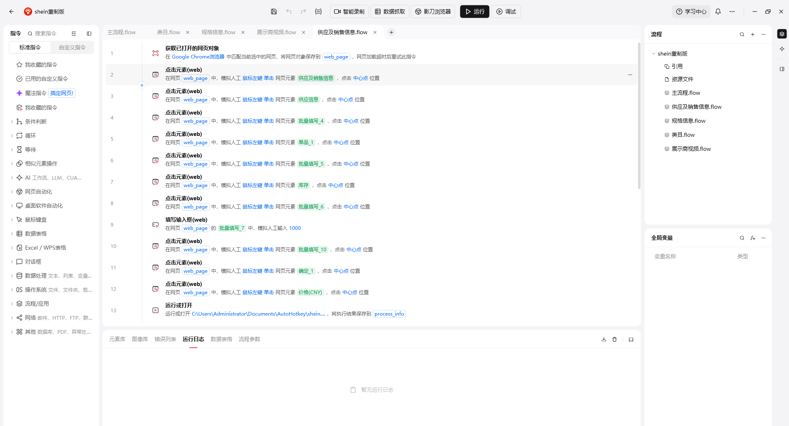
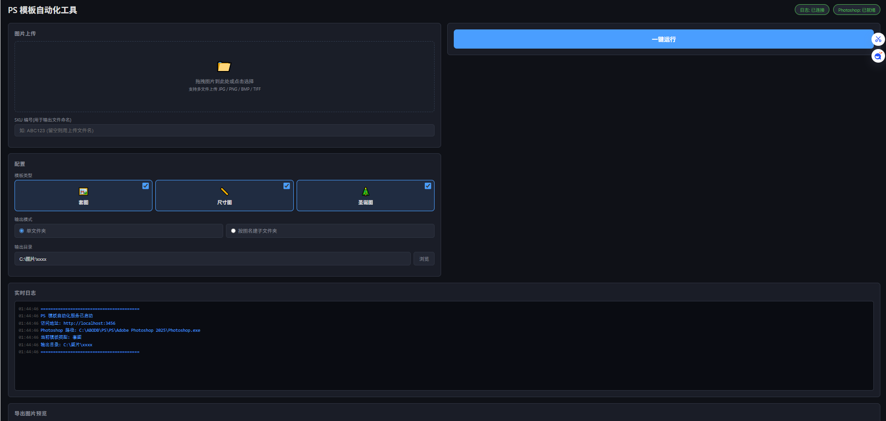

店铺上架流程自动化工具（RPA 填表 + PS 批量做图）
================================================

> 这是我为自家跨境店铺做的一套上架自动化工具，分两部分：
> **填表自动化**（RPA）和 **做图自动化**（PS 批量处理）。
> 从 2026 年 3 月开始做，一直在用和维护。
>
> **这份文档是我自己写的。**

---

## 一、为什么要做

店铺的日常任务分两块：**选品**和**上架**。

选品比较简单，用眼睛看、用审美去感受就行。

但上架不一样，上架又分两块：**做图**和**填表**。这两块都是**重复性劳动**——
而重复性劳动做多了容易眼花，眼花就会出错。

所以我决定把这两块都自动化掉。

---

## 二、第一部分：填表自动化（RPA）



### 我是怎么发现可以自动化的

我先看了一遍填表的过程，发现一件事：

> **填表时候大部分内容都是一样的，只有少部分内容需要改变。**

也就是说，这个任务里绝大多数的字段是**固定值**，只有少数几个是每次要变的。

这就是可以做自动化的信号。

### 做了什么

1. **先在网上找工具。** 搜索了很多，最后找到 **影刀 RPA**。
2. **简单学习了一些需要用到的技能**，就开始做了。
3. 把**固定的内容做成 RPA 自动填写**的部分，只保留变量字段人工填。

流程拆成了几个子模块（主流程 / 类目 / 规格信息 / 展示图视频 / 供应及销售信息），
方便单个环节出问题时单独改，不用动整条流程。

### 遇到的两个问题

**问题 1：平台会改版，工具需要一直维护**

> 平台填表也不是一直不变的，我后面还需要一直维护。

我没有把它做成一次性的东西，而是留了可以改的结构。

**问题 2：免费版只能自己做，不能给别人用**

一开始只有我自己能用。我想让**我嫂子也能用上**这个工具，
但影刀免费版只能做出来自己用，只有企业版可以分享给别人——**但太贵了**。

**我的处理**：我在网上找了一个网友做的小软件（AutoHotkey 方案），
**绕过了 RPA 软件的这个限制**，这样我嫂子也能用上。

### 效果

| | 原来 | 现在 |
|---|---|---|
| 单次填表耗时 | 约 5 分钟 | 约 3 分钟 |
| 数据稳定性 | 手工填，容易眼花出错 | **稳定** |
| 可维护性 | — | 平台改版后可修改 |
| 可分享 | 只有我能用 | **嫂子也能用** |

> **说明**：单看时间只省了 2 分钟，但真正的收益是**数据稳定**。
> 手工重复填表的主要风险不是慢，是**看串行、填错值**——
> 而这种错误在上架环节是要返工的，返工成本远大于这 2 分钟。

---

## 三、第二部分：做图自动化（PS 批量处理）



### 起因

做了一段时间以后，**我对做图这个部分也开始烦了**——
因为这同样是个重复性的劳动。

### 第一版（失败的一版）

我开始询问 AI 怎么样操控让 PS 自动做图，最后还真做出来了。

但我原本的想法太大了：

```
【原设计】
一张图片 → 工具自动提取印花 → 交给 PS 做出套图
```

**问题出在哪里：**

- 提取印花的网站**不是很稳定，经常崩溃**
- 而且因为**错误关闭的原因，经常造成数据挤兑**（任务堆积，软件不能正常使用）

这一版实际上**不可用**。

### 第二版（现在在用的）

> **在这个原因之下，我又做出新版的工具，剥离了提取印花的步骤，
> 只保留了自动处理 PS 文件的功能。**

**思路的转变**：不再试图把整个流程端到端自动化，
而是**砍掉不可靠的外部依赖**，只保留稳定、可重复的那一段。

| | 第一版 | 第二版 |
|---|---|---|
| 覆盖范围 | 提取印花 + PS 套图 | 只做 PS 批量处理 |
| 外部依赖 | 依赖第三方网站（不稳定） | 无 |
| 稳定性 | 经常崩溃、数据挤兑 | 稳定可用 |

### 它长什么样

是一个**本地网页界面**，不是命令行工具——因为要给我嫂子用，
所以必须做到"打开就能点"。

| 功能区 | 说明 |
|---|---|
| 图片上传 | 拖拽或点击，支持 JPG / PNG / BMP / TIFF，可多选 |
| SKU 编号 | 用于给输出文件命名（留空则用原文件名）|
| 模板类型 | 支持**三种模板**：套图 / 尺寸图 / 圣诞毯图，可多选 |
| 输出模式 | 单文件夹，或按图名建子文件夹 |
| 一键运行 | 启动后由程序驱动 Photoshop 批量套模板 |
| 实时日志 | 显示 PS 连接状态、模板类型、输出目录 |

### 效果

- **一次运行输出 17 张图**
- 不需要手动一张张套模板

---

## 四、这两个工具教会我什么

| # | 收获 |
|---|---|
| 1 | **先找规律，再动手**。发现"大部分字段是固定的"，才决定做自动化 |
| 2 | **工具不是一次性的**。平台会改，所以要留可维护的结构 |
| 3 | **做不成的东西要砍掉，而不是硬修**。第一版死在依赖不稳定的外部服务上，解决方式不是去修那个网站，是把它去掉 |
| 4 | **自己不够用的时候，找别的办法**。企业版太贵，就找替代方案让嫂子也能用 |
| 5 | **给别人用的工具，界面比功能重要**。所以我把它做成了网页而不是脚本 |
| 6 | **自动化的真正价值常常不是省时间，是减少出错** |

---

## 五、技术栈与环境

| 项 | 内容 |
|---|---|
| RPA 平台 | **影刀 RPA**（多子流程拆分）|
| 绕过分享限制 | AutoHotkey 方案（网友开发的小工具）|
| 做图自动化 | 本地 Web 界面（Python）+ 驱动 Photoshop 2025 批量套模板 |
| 运行环境 | 本地 Windows |
| 开始时间 | 2026 年 3 月 |
| 维护状态 | 持续维护中 |

---

## 六、已知不足

- 填表耗时只从 5 分钟降到 3 分钟，**提速有限**，主要收益在稳定性
- 做图工具**砍掉了印花提取环节**，这一段目前仍然是手工
- 依赖第三方小工具绕过 RPA 分享限制，**不是正规方案**，RPA 平台更新后可能失效
- 选品环节**没有自动化**，目前完全靠人工判断
- 界面只能本机访问，**没有做成多人协作**

---

## 七、如果重做一遍

- 先确认外部依赖稳不稳定，再决定要不要把它放进流程里
- 第一版就不该把"提取印花"和"PS 套图"做在一起
- 一开始就考虑别人也要用的情况（分享限制问题早点遇到，就能早点绕）
- 填表那部分可以做得更彻底：现在固定字段自动化了，但**变量字段的取值**还是靠人工去后台找

---

*最后更新：2026-10*
